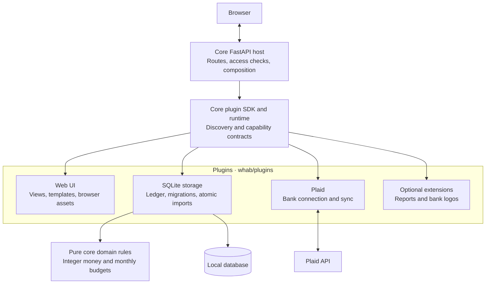

# WHAB — We Have A Budget

A local budgeting app with monthly envelopes and rollover, transaction review, spending analytics, manual accounts, CSV exports, and optional Plaid bank imports. Built with Python, FastAPI and Jinja; no Node.js build is required.

## Quick start

Requires **Python 3.14 or newer**. From the repository root:

```sh
cd whab
python3.14 -m venv .venv
.venv/bin/python -m pip install -e '.[dev]'
.venv/bin/python scripts/setup.py
.venv/bin/python -m whab
```

Open [127.0.0.1:5173](http://127.0.0.1:5173) to explore fictional demo data, or switch to **My budget** and add a manual account. Plaid credentials are only needed for bank connections.

## Architecture

The core hosts HTTP APIs and loads plugins through the public `whab.plugins` SDK. Arrows show runtime collaboration through those contracts; core code does not import concrete plugins.



Web and SQLite are the default interface and storage plugins. Plaid is optional and enabled by default; it imports normalized changes through a provider-scoped storage facade. Reports receive immutable snapshots, and bank logos receive institution text. Plugins run as trusted Python code in the server process. Headless mode keeps the APIs and storage with `WHAB_UI=`.

## Guides

- [Application setup and configuration](whab/README.md)
- [Local usage, Plaid setup, budgets and backups](whab/docs/usage.md)
- [Architecture and data flow](whab/docs/architecture.md)
- [Plugin API](whab/docs/plugins.md) and [plugin folders](whab/plugins/README.md)
- [Contributing and checks](whab/CONTRIBUTING.md) · [Changelog](whab/CHANGELOG.md)

## Limits and privacy

WHAB is a **local, USD-only prototype** without family authentication. Keep it bound to localhost. Plaid defaults to Sandbox; live connections require explicit configuration. Investment holdings, splits, manual/import reconciliation and a full credit-card payment model are not implemented.

Keep `.env`, `plugins.json` and financial data out of Git. Preserve the existing runtime home and token encryption key when upgrading; see the [backup guidance](whab/docs/usage.md#local-access-and-private-files).

## License

[MIT](LICENSE). Third-party dependencies, services and institution logos retain their own licenses or terms.
