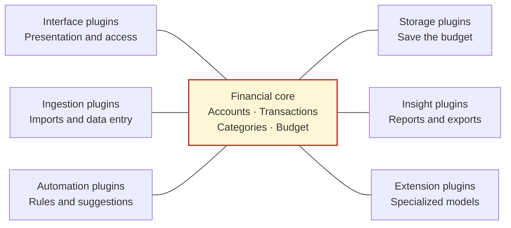
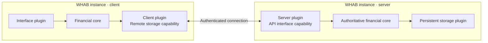

<p align="center">
  
</p>
<h1 align="center">WHAB</h1>
<p align="center"><strong>We Have A Budget</strong></p>

A highly extensible budgeting app built with Python. Plan with monthly envelopes and rollover, review transactions, explore spending analytics, and track manual accounts, with optional CSV exports and bank imports. Choose plugins to keep your setup as simple or as capable as you need.

## Quick start

Requires **Python 3.14 or newer**. From the repository root:

```sh
cd whab
python3.14 -m venv .venv
.venv/bin/python -m pip install -e '.[dev]'
.venv/bin/python scripts/setup.py
.venv/bin/python -m whab
```

Open [127.0.0.1:5173](http://127.0.0.1:5173) to explore fictional demo data, or switch to **My budget** and add a manual account. Plaid credentials are only needed for bank connections.

## Architecture

WHAB uses a **plugin architecture with a hexagonal financial core**. The core owns accounts, transactions, categories and budgets; replaceable plugins connect through defined contracts. A small host handles plugin discovery, configuration and lifecycle outside the financial rules.



Each surrounding box is a plugin family. A plugin can provide several capabilities, and each budget chooses the features it uses. Interfaces present the budget, ingestion normalizes incoming data, insights read scoped snapshots, and automations and extensions work through validated financial operations. At least one storage plugin saves the budget; multiple storage destinations hold copies of that same budget.

Plugin code is installed in WHAB. The budget owns its enabled plugins, settings and saved plugin state, so opening a portable budget restores its feature setup. Credentials and device-specific connections stay with the machine or server. See the [architecture guide](whab/docs/architecture.md) and [budget and plugin model](whab/docs/target-architecture.md) for the implemented contracts and capability boundaries.

Concrete plugins live under `whab/plugins/<category>/<id>/`. The categories are `interface`, `ingestion`, `insight`, `storage`, `automation`, `extension` and `example`; the last holds teaching plugins. See [folder ownership and naming](whab/plugins/README.md).

### Client/server deployment

The same architecture supports separating presentation from persistence. A **client plugin** connects an interface to a remote budget; a **server plugin** provides an API interface through which the server's financial core validates budget operations.



A plugin's primary category describes its role; its capabilities can include connection controls, interface contributions and storage. The budget describes its features, while the deployment selects where each capability runs. Bank ingestion and credentials stay on the server; clients use scoped ledger operations. See [deployment boundaries](whab/docs/target-architecture.md#clientserver-deployment) for ownership and the remote contract.

## Guides

- [Application setup and configuration](whab/README.md)
- [Usage, bank imports, portable budgets and backups](whab/docs/usage.md)
- [Architecture](whab/docs/architecture.md) and [budget and plugin model](whab/docs/target-architecture.md)
- [Plugin API](whab/docs/plugins.md) and [plugin folders](whab/plugins/README.md)
- [Contributing and checks](whab/CONTRIBUTING.md) · [Changelog](whab/CHANGELOG.md)

## Privacy and control

Your budget, your setup. WHAB can run completely locally in an isolated environment. Enable plugins when you need their capabilities, choose which services they connect to, and disable them when you no longer need them. This keeps your environment minimal, understandable and under your control. Plugins run as trusted Python code, so choose the code and connections you enable deliberately.

## License

[MIT](LICENSE). Third-party dependencies, services and assets retain their own licenses or terms.
