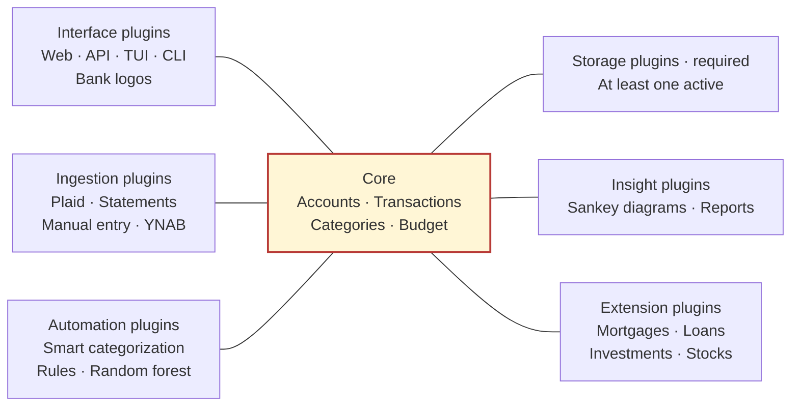
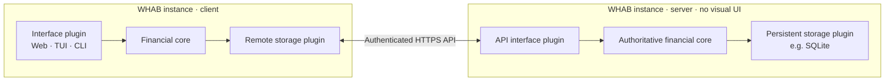

# WHAB — We Have A Budget

A local budgeting app with monthly envelopes and rollover, transaction review, spending analytics, manual accounts, CSV exports, and optional Plaid bank imports. Built with Python, FastAPI and Jinja; no Node.js build is required.

## Quick start

Requires **Python 3.14 or newer**. From the repository root:

```sh
cd whab
python3.14 -m venv .venv
.venv/bin/python -m pip install -e '.[dev]'
.venv/bin/python scripts/setup.py
.venv/bin/python -m whab
```

Open [127.0.0.1:5173](http://127.0.0.1:5173) to explore fictional demo data, or switch to **My budget** and add a manual account. Plaid credentials are only needed for bank connections.

## Architecture

**Proposed direction:** a minimal financial core for accounts, transactions, categories and budgets. Almost everything else is supplied by plugins. A small host handles plugin discovery, capability contracts and lifecycle outside the domain core.



Each surrounding box is a plugin family; connections show capability boundaries around the core, not code imports. At least one storage plugin must be active, and multiple storage plugins may be selected. Interactive use needs at least one usable interface. Bank logos enhance an interface. One plugin may supply several capabilities.

The core validates every ledger change and owns financial rules. Ingestion submits normalized inputs, Insight reads snapshots, Extension adds specialized models, and Automation suggests or applies configured actions through core commands. Random forest is one replaceable categorization implementation.

Contributor folders use singular category names under `whab/plugins/`: `interface`, `ingestion`, `insight`, `storage`, `automation`, `extension` and `example`. Each plugin owns `plugins/<category>/<id>/`; see [folder ownership and naming](whab/plugins/README.md). The example category contains teaching plugins rather than an additional runtime capability.

This is a design proposal. The current app still owns its HTTP API, and SDK v1 does not yet support all of these capabilities. See the [target design](whab/docs/target-architecture.md) and [current implementation](whab/docs/architecture.md).

### Alternative proposal: client and server

Two WHAB instances could separate the interface from persistent storage. The **client** runs an interface and selects a remote storage plugin that forwards ledger reads and changes to the other instance's API. The **server** runs headlessly, with an **API interface plugin** as its only interface, and uses a storage plugin such as SQLite to keep the authoritative ledger.



The server validates every change before saving it. Bank ingestion and credentials stay on the server; the client uses scoped ledger operations. This proposal requires a remote storage plugin, a defined remote API contract, authentication and authorization. Headless mode (`WHAB_UI=`) exists today with a host-owned API, but this client/server deployment is **not implemented**; the current app remains local only. See the [client/server design proposal](whab/docs/target-architecture.md#clientserver-deployment-proposal) for ownership and consistency requirements.

## Guides

- [Application setup and configuration](whab/README.md)
- [Local usage, Plaid setup, budgets and backups](whab/docs/usage.md)
- [Target architecture](whab/docs/target-architecture.md) and [current implementation](whab/docs/architecture.md)
- [Plugin API](whab/docs/plugins.md) and [plugin folders](whab/plugins/README.md)
- [Contributing and checks](whab/CONTRIBUTING.md) · [Changelog](whab/CHANGELOG.md)

## Limits and privacy

WHAB is a **local, USD-only prototype** without family authentication. Keep it bound to localhost. Plaid defaults to Sandbox; live connections require explicit configuration. Investment holdings, splits, manual/import reconciliation and a full credit-card payment model are not implemented.

Keep `.env`, `plugins.json` and financial data out of Git. Preserve the existing runtime home and token encryption key when upgrading; see the [backup guidance](whab/docs/usage.md#local-access-and-private-files).

## License

[MIT](LICENSE). Third-party dependencies, services and institution logos retain their own licenses or terms.
