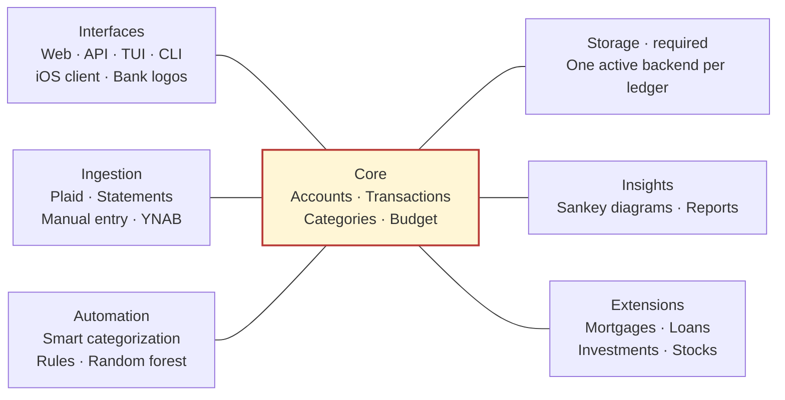

# WHAB — We Have A Budget

A local budgeting app with monthly envelopes and rollover, transaction review, spending analytics, manual accounts, CSV exports, and optional Plaid bank imports. Built with Python, FastAPI and Jinja; no Node.js build is required.

## Quick start

Requires **Python 3.14 or newer**. From the repository root:

```sh
cd whab
python3.14 -m venv .venv
.venv/bin/python -m pip install -e '.[dev]'
.venv/bin/python scripts/setup.py
.venv/bin/python -m whab
```

Open [127.0.0.1:5173](http://127.0.0.1:5173) to explore fictional demo data, or switch to **My budget** and add a manual account. Plaid credentials are only needed for bank connections.

## Architecture

**Proposed direction:** a minimal financial core for accounts, transactions, categories and budgets. Almost everything else is supplied by plugins. A small host handles plugin discovery, capability contracts and lifecycle outside the domain core.



Connections show capability boundaries around the core, not code imports. Storage is a required capability with exactly one active backend per ledger; other families can have several plugins. Interactive use needs at least one usable interface. Bank logos enhance an interface; an iOS app is a separate client, usually using the API interface. One plugin may supply several capabilities.

The core validates every ledger change and owns financial rules. Ingestion submits normalized inputs, Insights reads snapshots, Extensions adds specialized models, and Automation suggests or applies configured actions through core commands. Random forest is one replaceable categorization implementation.

This is a design proposal. The current app still owns its HTTP API, and SDK v1 does not yet support all of these capabilities. See the [target design](whab/docs/target-architecture.md) and [current implementation](whab/docs/architecture.md).

## Guides

- [Application setup and configuration](whab/README.md)
- [Local usage, Plaid setup, budgets and backups](whab/docs/usage.md)
- [Target architecture](whab/docs/target-architecture.md) and [current implementation](whab/docs/architecture.md)
- [Plugin API](whab/docs/plugins.md) and [plugin folders](whab/plugins/README.md)
- [Contributing and checks](whab/CONTRIBUTING.md) · [Changelog](whab/CHANGELOG.md)

## Limits and privacy

WHAB is a **local, USD-only prototype** without family authentication. Keep it bound to localhost. Plaid defaults to Sandbox; live connections require explicit configuration. Investment holdings, splits, manual/import reconciliation and a full credit-card payment model are not implemented.

Keep `.env`, `plugins.json` and financial data out of Git. Preserve the existing runtime home and token encryption key when upgrading; see the [backup guidance](whab/docs/usage.md#local-access-and-private-files).

## License

[MIT](LICENSE). Third-party dependencies, services and institution logos retain their own licenses or terms.
